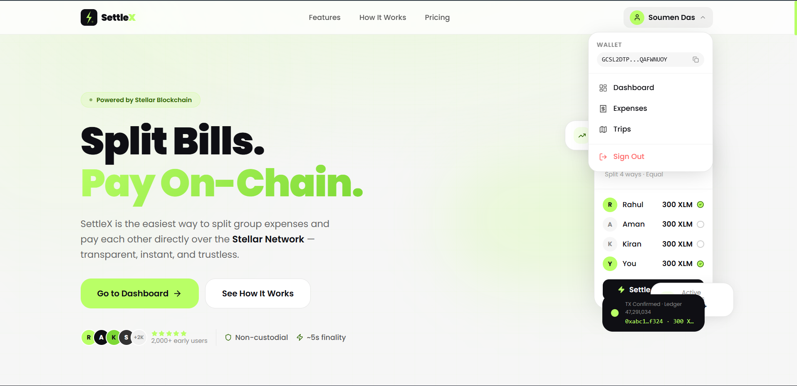
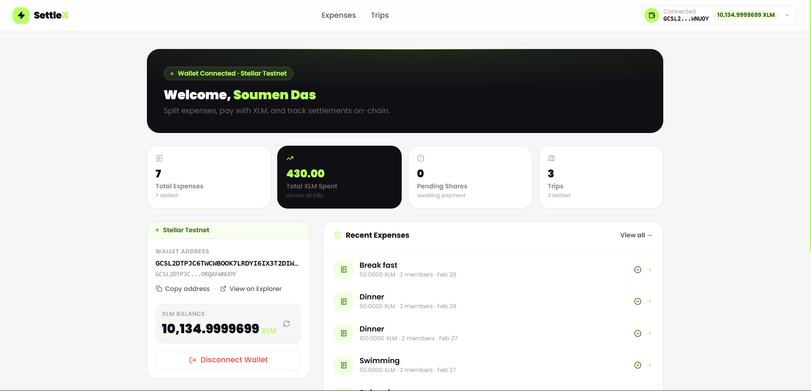
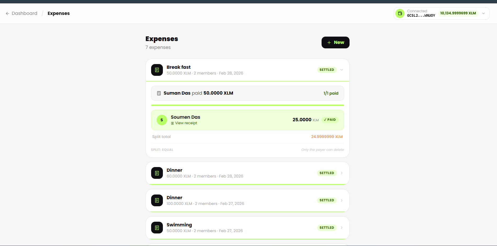
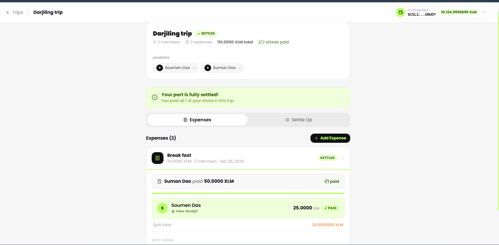
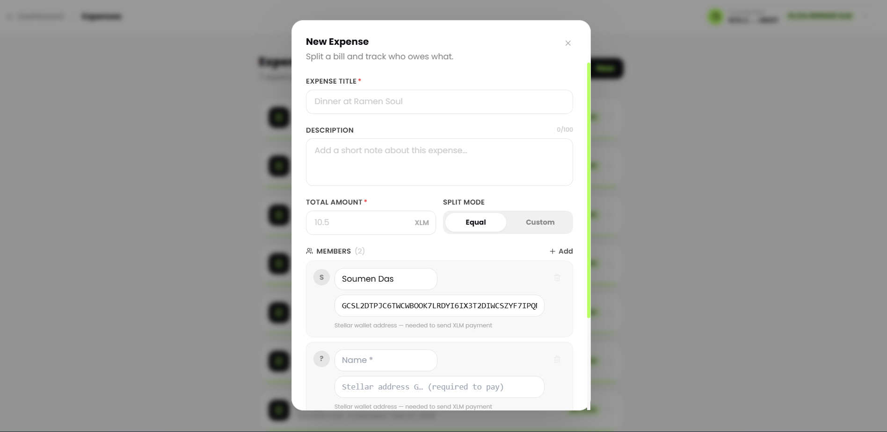
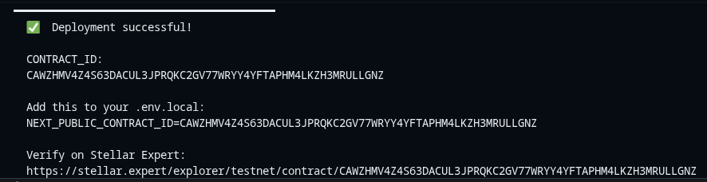

<p align="center">
  
</p>

<h1 align="center">SettleX — Split Bills. Pay On-Chain.</h1>

<p align="center">
  A decentralised expense-splitting application built on the <strong>Stellar Network</strong>.<br/>
  Add group expenses, split them by any method, and settle every share directly from your wallet — confirmed on-chain in under 5 seconds.
</p>

<p align="center">
  <a href="https://stellar.expert/explorer/testnet/contract/CAXVH54JVEUCLDQQW45SMRFTCAAVUGVBT4SBVLAGYDQ2YMAPK6YL6ADI">
    
  </a>
  <a href="https://stellar.expert/explorer/testnet/tx/f05c2f59f980a00e99f3f00d57e22b8b10fd0405064096273fd912c9b05a037e">
    
  </a>
  <a href="https://github.com/SnigdhaMandal/SettleX/actions/workflows/ci.yml">
    
  </a>
  
  
</p>

<p align="center">
  <a href="https://settle-x-pi.vercel.app/"><strong>Live Demo</strong></a> &nbsp;&bull;&nbsp;
  <a href="https://youtu.be/gnUaUONmb3I"><strong>Demo Video</strong></a>
</p>

---

## Table of Contents

- [Project Description](#project-description)
- [Features](#features)
- [Tech Stack](#tech-stack)
- [Screenshots](#screenshots)
- [How It Works](#how-it-works)
- [Smart Contract](#smart-contract)
- [Setup Instructions](#setup-instructions)
- [Environment Variables](#environment-variables)
- [Wallet Authentication](#wallet-authentication)
- [Testing](#testing)
- [Project Structure](#project-structure)
- [Testnet Notes](#testnet-notes)
- [Final Documentation Package](#final-documentation-package)

---

## Project Description

SettleX solves a fundamental problem with group expense sharing: apps like Splitwise only track IOUs — you still have to chase people for real money. SettleX closes the loop by connecting split calculations directly to on-chain payments.

Every payment produces a **real, verifiable transaction hash** on the Stellar blockchain — that hash, checkable on any explorer, is the evidence a payment happened. An on-chain Soroban smart contract additionally records each settlement so participants share one append-only history. Those records are currently *self-attested*: the contract stores what the member submits without checking it against Horizon, so treat the Stellar transaction as the proof and the contract record as bookkeeping (see [Architecture and Limitations](docs/ARCHITECTURE_AND_LIMITATIONS.md)). The app refreshes shared expenses and trips about every five seconds while a page is visible.

**Core design principles:**

- **Non-custodial** — your private key never leaves your wallet extension. SettleX only receives the signed transaction envelope.
- **No intermediary** — money moves peer-to-peer between Stellar wallets; the app never holds funds.
- **On-chain receipts** — every settled share has a Stellar transaction hash you can verify on [stellar.expert](https://stellar.expert/explorer/testnet).
- **Multi-wallet** — supports Freighter, xBull, Lobstr, and Rabet with install detection. WalletConnect is not currently configured in this app.

---

## Features

| Feature                                                      | Status |
| ------------------------------------------------------------ | ------ |
| Multi-wallet connect (Freighter, xBull, Lobstr, Rabet)      | Live   |
| Create and split expenses: equal or custom weight | Live   |
| Pay shares with XLM (Stellar Payment operation)              | Live   |
| SEP-0007 QR code generation for mobile wallets               | Live   |
| Transaction hash receipt linked to Stellar Explorer          | Live   |
| Soroban contract: append-only on-chain settlement records     | Live   |
| Real-time event listening from contract (`pmt_rec` events)   | Live   |
| Attestor-backed payment verification                         | Not live yet |
| Trip mode — group expenses with net-balance settle-up        | Live   |
| Cross-user expense/trip sync via secure 5-second polling     | Live   |
| Net-balance algorithm (minimises transactions needed)        | Live   |
| Mobile-responsive UI                                         | Live   |

---

## Tech Stack

| Layer            | Technology                                     |
| ---------------- | ---------------------------------------------- |
| Framework        | Next.js 14 (App Router, TypeScript)            |
| Styling          | Tailwind CSS 3.4, Framer Motion                |
| Blockchain SDK   | `@stellar/stellar-sdk` v14                     |
| Wallet support   | `@creit.tech/stellar-wallets-kit` v2          |
| Smart contract   | Soroban (Rust, `soroban-sdk` v22)              |
| Network          | Stellar Testnet (Horizon + Soroban RPC)        |
| Database         | Supabase (PostgreSQL via authenticated Next.js proxy) |
| QR codes         | `qrcode.react`                                 |
| Testing          | Jest 29 + ts-jest (379 tests)              |
| State management | React Context + HttpOnly session cookie + localStorage cache |
| UI primitives    | Radix UI, Lucide React                         |

---

## Screenshots

### Home / Landing Page



---

### Dashboard — Wallet Connected & Balance Displayed

The dashboard shows your connected public key, live XLM balance fetched from Horizon, and the Testnet indicator.



---

### Expenses — Wallet Options & Split View

The multi-wallet selector lets users connect via Freighter, xBull, or Lobstr. Wallets not installed show an "Install" badge. Below it the expenses list shows split breakdowns with Pay XLM buttons per share.



---

### Trips Overview



---

### New Expense Form

Define members, set amounts, and choose equal or custom-weight split mode. The form calculates each share in real time.



---

### Deployment Proof (CLI)

Fresh testnet deployment output and contract ID confirmation.



---

## How It Works

```
User connects wallet (Freighter / xBull / Lobstr)
              |
User creates expense, adds members, picks split mode
              |
App calculates each member's exact share
              |
Payer clicks "Pay XLM"
              |
    +---------+-----------+
    |                     |
buildTransaction()    checkIsPaid()     <- on-chain duplicate check (Soroban)
    |
TransactionBuilder constructs Payment operation
  · from:   payer public key
  · to:     payee Stellar address
  · amount: share amount in XLM
  · memo:   share identifier (see "Payment memos" below)
    |
Wallet extension signs client-side
(private key never leaves the browser)
    |
Signed envelope submitted to Horizon REST API
    |
Stellar validators confirm in ~5 seconds
    |
recordPaymentOnChain() stores to Soroban contract:
  trip_id, expense_id, payer, member, amount, tx_hash
    |
tx hash stored in app, share marked "paid"
useContractEvents polls every 10s -> displays contract events; it does not sync application state
```

### Payment memos

Every SettleX payment carries a 28-byte `MEMO_TEXT` that identifies exactly what it pays. The same functions in [`lib/stellar/memo.ts`](lib/stellar/memo.ts) build it for the in-app Pay button, the QR code and trip settle-up:

| Memo | Pays | Built from |
| --- | --- | --- |
| `SX1S:<23 base32 chars>` | one member's share of one expense | `sha256("settlex:share:v1:<expenseId>:<memberId>")` |
| `SX1N:<23 base32 chars>` | one netted trip settlement | `sha256("settlex:settle:v1:<tripId>:<FROM_WALLET>:<TO_WALLET>")` |

The memo is a one-way digest, so the public ledger shows no expense titles or member names. Anyone who can see the expense can recompute it. Given a transaction hash, `lookupPaymentByTxHash()` reads the memo from Horizon and returns the share or settlement it pays. For older payments made before share identifiers, it falls back to the share whose recorded `txHash` matches. `buildPaymentTransaction()` rejects any memo that is not in this format.

### QR payments (SEP-0007)

A share's QR code is a `web+stellar:pay` URI that pays the **creditor** (the member who paid the bill) the share's exact 7-decimal amount, with the share's memo. It always includes `network_passphrase`, because SEP-0007 wallets assume Mainnet when it is missing, and all values are percent-encoded. A payment made from another wallet app returns no hash to SettleX, so the share owner pastes the transaction hash under the QR ("I paid via QR"). It is recorded only if Horizon shows a successful native XLM payment with this share's memo, from the share's wallet to the creditor, for exactly the share amount. QR URIs are unsigned: `origin_domain` and `signature` need a URI-signing key published in the app's `stellar.toml`, which this deployment does not have.

---

## Smart Contract

SettleX deploys a single **Soroban smart contract** on Stellar Testnet as an append-only receipt log of settled payments.

**What the contract does and does not do.** The XLM moves in an ordinary Horizon payment that the debtor signs. Afterwards the debtor calls `record_payment`, which stores the payment's transaction hash against `(trip, expense, member)`. `record_payment` is a pure ledger write: it makes **no cross-contract call**, transfers no tokens, and checks or consumes no balance anywhere. There is no pool contract in this repository.

### Deployed Contracts (Testnet)

| Contract Role | Contract ID | Explorer |
| ------------- | ----------- | -------- |
| Settlement contract | `CAXVH54JVEUCLDQQW45SMRFTCAAVUGVBT4SBVLAGYDQ2YMAPK6YL6ADI` | [View](https://stellar.expert/explorer/testnet/contract/CAXVH54JVEUCLDQQW45SMRFTCAAVUGVBT4SBVLAGYDQ2YMAPK6YL6ADI) |

Network: Stellar Testnet  
Language: Rust (`soroban-sdk` v22.0.11)

### Verified On-Chain Transactions

- Settlement deploy tx: [826092e11281bd8fe3c8997ef0a4886b1bd3728069c6855ec4e3866f0a8f9d06](https://stellar.expert/explorer/testnet/tx/826092e11281bd8fe3c8997ef0a4886b1bd3728069c6855ec4e3866f0a8f9d06)
- Settlement init tx (`stx_ini`): [f05c2f59f980a00e99f3f00d57e22b8b10fd0405064096273fd912c9b05a037e](https://stellar.expert/explorer/testnet/tx/f05c2f59f980a00e99f3f00d57e22b8b10fd0405064096273fd912c9b05a037e)

Earlier README revisions listed a pool contract (`CB4P4EXL…53JA`) and cited a
"pool interaction" transaction (`04c679c7…`) as proof that `record_payment`
withdraws from the pool in the same transaction. That claim does not match the
code: `record_payment` has never consumed pool credits in the current source,
and the pool contract has been removed from the repository (Issue #178). The
old pool instance on testnet is unused by SettleX and must not be treated as
part of the deployment.

New deployments must use [`scripts/deploy-contract.sh`](scripts/deploy-contract.sh).
The settlement contract uses a Soroban constructor, so its admin state is
initialized atomically during deployment. Do not deploy the WASM and call
`init` manually; that legacy entry point rejects calls after constructor
initialization and is retained only for compatibility with older instances.

Security hardening note:
- `record_payment` requires the debtor's (`member`) signature and makes no nested contract call; `test_record_payment_makes_no_cross_contract_call` asserts that the only authorization in the call tree is the member's, with no sub-invocations.
- Settlement records now carry an `attested` flag. With no attestor configured a record is **self-attested** — it proves only that a member wrote a string, and the contract verifies neither the `payer`, the `amount`, nor the `tx_hash` against Horizon. Treat the Stellar transaction on the explorer as the evidence, not the in-app record. `set_attestor` makes a verifier's co-signature mandatory and marks records `attested: true`; the verifier service itself is not yet built, so attestor-backed verification is not live in this repo.
- `clear_paid` (admin-only) clears the `ExpensePaid` flag, so a bogus or mistaken record can no longer permanently block the legitimate one. It preserves the original entry in trip history.

> **Schema note.** `PaymentRecord` gained the `attested` field in settlement schema v2. Upgrade and `migrate` older settlement instances before use.

---

## Project Status & Production Roadmap

**Status: Testnet beta.** SettleX runs entirely on Stellar **Testnet** — no real
funds move yet. Settlement currently uses native **XLM**. USDC settlement,
verified on-chain settlement, broader wallet support, and a Mainnet launch are on
the roadmap. We state exactly where we are rather than overselling.

The project roadmap and known trust boundaries are documented in [docs/PRODUCT_CONVERSION_GUIDE.md](docs/PRODUCT_CONVERSION_GUIDE.md).

| Area | Today | Next |
| --- | --- | --- |
| Network | Stellar Testnet | Mainnet (after a contract audit) |
| Settlement asset | XLM (native) | USDC via Stellar path payments |
| Settlement integrity | On-chain receipt log; transaction not verified in-contract | Verified / atomic on-chain settlement |
| Wallets | Freighter, xBull, Lobstr, Rabet | Additional wallet options |
| App shell | Installable PWA, nonce-based CSP | Push notifications, offline reads |
| Identity | Sign-In-With-Stellar (verified signed challenge) | Further account and recovery options |

### Contract Functions

#### Settlement Contract (SettleXContract)

| Function | Type | Authorization | Purpose |
| --- | --- | --- | --- |
| __constructor(admin) | Constructor | Admin | Initializes admin and schema version at deployment |
| init(admin) | Write | Admin | Legacy initializer for instances deployed without a constructor |
| upgrade(new_wasm_hash) | Write | Admin | Installs a new WASM version |
| migrate() | Write | Admin | Migrates supported older state to the current schema |
| set_attestor(attestor) | Write | Admin | Requires a verifier signature on future records |
| clear_attestor() | Write | Admin | Removes the verifier requirement |
| get_attestor() | Read | None | Returns the configured verifier, if any |
| clear_paid(expense_id, member) | Write | Admin | Clears the paid marker while retaining audit history |
| record_payment(trip_id, expense_id, payer, member, amount, tx_hash) | Write | Member and configured attestor | Records a receipt; it transfers no funds and makes no cross-contract call |
| get_payments(trip_id, offset, limit) | Read | None | Reads a bounded page of trip history |
| is_paid(expense_id, member) | Read | None | Checks the paid marker |
| extend_trip(trip_id, payment_offset, expense_offset, limit) | Write | Permissionless | Renews storage TTL for bounded history pages |

### Contract Error Codes

The contract defines errors 1-14; meanings and validation cases are listed below.

| Code | Name | Meaning |
| --- | --- | --- |
| 1 | InvalidAmount | Amount is zero or negative |
| 2 | AlreadyPaid | Share already has a paid marker |
| 3 | EmptyId | Required trip or expense ID is empty |
| 4 | AlreadyInitialized | Contract initialization was already performed |
| 5 | NotInitialized | Contract state has not been initialized |
| 6 | InvalidActor | Invalid actor combination, including payer=member or attestor=admin |
| 7 | IdTooLong | Trip or expense ID exceeds 64 bytes |
| 8 | AmountTooLarge | Amount exceeds 1e15 stroops (1e8 XLM) |
| 9 | VersionMismatch | Contract state version is unsupported |
| 10 | TxHashTooLong | Transaction hash validation failed |
| 11 | NotPaid | No paid marker exists to clear |
| 12 | Unauthorized | Required admin or attestor authorization is missing |
| 13 | InvalidPage | Page limit or pagination parameters are invalid |
| 14 | IndexOverflow | Bounded trip index reached capacity |

### Why a Smart Contract?

In a Horizon-only setup there is no shared source of truth for payment status — any user could mark a share as paid without actually transferring XLM. The Soroban contract solves this:

- `record_payment` stores the real Stellar `tx_hash` as proof of transfer.
- `is_paid` acts as a duplicate guard — re-settling an already-paid share is rejected on-chain with `AlreadyPaid (#2)`.
- All records are permanently on the Stellar ledger and cannot be modified or deleted by anyone, including the app operator.

### Real-Time Events

The contract emits a `pmt_rec` event for every confirmed payment. `hooks/useContractEvents.ts` polls the Soroban RPC every 10 seconds and on browser tab focus. The hook exposes fetched events for display; it does not write to Supabase or synchronize application state.

---

## Setup Instructions

### Prerequisites

- **Node.js** v20 or later
- **npm** v10 or later
- **Freighter Wallet** browser extension — [freighter.app](https://freighter.app)
  - In Freighter: Settings → Network → select **Testnet**
- A funded Stellar Testnet account — get free XLM from [Stellar Friendbot](https://horizon-testnet.stellar.org/friendbot?addr=YOUR_PUBLIC_KEY)

### 1. Clone the repository

```bash
git clone https://github.com/SnigdhaMandal/SettleX.git
cd SettleX
```

### 2. Install dependencies

```bash
npm install
```

### 3. Create a Supabase project

Supabase is required for authentication and application data. Run the SQL setup and configure the Supabase URL, anon key, and wallet-authentication secrets before starting the app.

1. Create a free project at [supabase.com](https://supabase.com).
2. In the SQL Editor, run the full schema from [`supabase-setup.sql`](supabase-setup.sql) (or follow [docs/SUPABASE_SETUP.md](docs/SUPABASE_SETUP.md) for a walkthrough).
3. Copy your **Project URL** and **anon key** from Project Settings → API.
4. Copy your **JWT Secret** from the same page into `SUPABASE_JWT_SECRET`. Row Level Security authorizes on a `wallet_address` claim that the app's server signs with this secret — without it, every database call is rejected. See [Wallet Authentication](#wallet-authentication).

### 4. Configure environment variables

```bash
cp .env.local.example .env.local
```

Fill in your Supabase credentials. The Stellar network and RPC URL defaults target Testnet. Set the empty NEXT_PUBLIC_CONTRACT_ID to a deployed settlement contract ID, and configure the Supabase and server auth values below. See [Environment Variables](#environment-variables) for the full reference.

### 5. Start the development server

```bash
npm run dev
```

Open [http://localhost:3000](http://localhost:3000) and connect your Freighter wallet (set to Testnet).

### 6. Build for production

```bash
npm run build
npm run start
```

---

## Environment Variables

Create .env.local from .env.local.example. The contract ID is intentionally blank in the example; choose a deployed settlement contract. NEXT_PUBLIC_SITE_URL should be your local or deployed origin.

| Variable | Purpose |
| --- | --- |
| NEXT_PUBLIC_STELLAR_NETWORK | Stellar network (TESTNET for local setup) |
| NEXT_PUBLIC_HORIZON_URL | Horizon API endpoint |
| NEXT_PUBLIC_STELLAR_EXPLORER | Explorer base URL |
| NEXT_PUBLIC_SOROBAN_RPC_URL | Soroban RPC endpoint |
| NEXT_PUBLIC_CONTRACT_ID | Deployed settlement contract ID; required and blank in the example |
| NEXT_PUBLIC_SUPABASE_URL | Supabase project URL |
| NEXT_PUBLIC_SUPABASE_ANON_KEY | Public Supabase anon key |
| SUPABASE_JWT_SECRET | Signs wallet-authenticated JWTs used by RLS |
| AUTH_CHALLENGE_SECRET | Challenge HMAC secret; required in production and different from JWT secret |
| AUTH_SESSION_TTL_SECONDS | Optional token lifetime; defaults to 3600 seconds (1 hour), capped at 43200 seconds (12 hours) |
| SUPABASE_SERVICE_ROLE_KEY | Server-only shared nonce/rate-limit store and session revocation; recommended locally and needed for cross-instance protections |
| NEXT_PUBLIC_SITE_URL | Canonical application URL for metadata and PWA links |
| NEXT_PUBLIC_APP_NAME, NEXT_PUBLIC_APP_VERSION | Display metadata |

Never expose SUPABASE_JWT_SECRET, AUTH_CHALLENGE_SECRET, or SUPABASE_SERVICE_ROLE_KEY with a NEXT_PUBLIC_ prefix. Review .env.local.example and [Authentication Setup](docs/AUTHENTICATION_SETUP.md) for production configuration.

---

## Wallet Authentication

Your Stellar address is your identity, and the app proves you control it before the database will accept it — a SEP-10 style challenge/response:

1. **Challenge** — `POST /api/auth/challenge` returns a transaction built for your address with **sequence number 0**, carrying a random nonce. Sequence 0 is always below an account's real sequence, so the network can never accept it: it is signable but unsubmittable, and costs no fee.
2. **Sign** — your wallet (Freighter, xBull, Lobstr) signs it locally. Your private key never leaves the extension.
3. **Verify** — `POST /api/auth/verify` checks the signature against the claimed public key and, only on success, mints a short-lived Supabase JWT whose `wallet_address` claim carries the proven address. The token is signed with `SUPABASE_JWT_SECRET`, which never reaches the browser.
4. **Authorize** — `/api/auth/verify` sets the JWT as an `HttpOnly`, `SameSite=Lax` cookie and does not return it in JSON. Supabase REST calls go through same-origin Next.js handlers, which validate the cookie and forward the JWT to PostgREST. Every RLS policy reads the claim via `public.settlex_wallet()`; requests without a valid token get no rows.

The browser never reads or stores the JWT in `localStorage`; only non-secret session metadata is held in memory. The cookie survives reloads until expiry (one hour by default, configurable up to 12 hours), so a valid session can be checked on reload without another signature. Near expiry, the UI asks the wallet to sign again. Because an HttpOnly cookie cannot authenticate a browser WebSocket, expense and trip updates use five-second polling while the page is visible instead of Supabase Realtime. This is slightly less immediate but keeps the bearer token out of JavaScript. HttpOnly prevents token extraction, but an XSS can still perform actions through the active page until the session expires or is signed out.

> **Upgrading an existing deployment:** earlier versions authorized on an `x-wallet-address` request header that the browser set itself. Because the anon key is public, anyone could send that header with any address and read or modify every user's data. Re-run [`supabase-setup.sql`](supabase-setup.sql) to replace those policies and set `SUPABASE_JWT_SECRET`. Until you do, the data layer is effectively unauthenticated.

---

## Testing

### JavaScript / TypeScript unit tests

```bash
npm test
```

For coverage report:

```bash
npm run test:coverage
```

| Test file                                 | Coverage                                                                                     |
| ----------------------------------------- | -------------------------------------------------------------------------------------------- |
| `__tests__/split/calculator.test.ts`      | Equal split, custom/weighted split, amount validation, Stellar address format checks         |
| `__tests__/settlement/netBalance.test.ts` | Net-balance algorithm: simple debt, netting, three-person chains, wallet address passthrough |
| `__tests__/utils/formatters.test.ts`      | `formatAddress`, `formatXLM`, `stroopsToXlm` conversions                                     |

**48 test suites and 379 tests** (repository counts). The checked-in public/test_pass.png is historical and does not represent the current count.

### Rust contract tests

```bash
cd contract
cargo test
```

The Rust suite covers initialization, authorization, upgrades and migration, attestor behavior, payment validation and duplicate guards, bounded history pagination, TTL extension, and event behavior. Consult contract/contracts/settlement/src/lib.rs for the current test names.

---

## Project Structure

```text
app/                    Next.js pages, auth/payment APIs, and health endpoint
  api/auth/             challenge, verify, session, and signout routes
  api/health/           deployment configuration health check
components/             auth, dashboard, expenses, landing, payment, PWA, trips, wallet, and UI
context/                auth, wallet, expense, and trip state
hooks/                  wallet, expense, trip, payment, and contract-event hooks
lib/auth/               challenge validation, JWT, revocation, rate limiting, and shared state
lib/config/             production environment requirements
lib/errors/             safe user-facing error mapping
lib/observability/      logging, redaction, request metrics, and Supabase error handling
lib/payments/           pending payments, QR reconciliation, and share ownership
lib/settlement/         net balances and trip settlements
lib/split/              expense split calculations
lib/stellar/            wallet, Horizon, Soroban, contract, event, and payment helpers
lib/supabase/           authenticated session proxy and row guards
supabase/               schema migrations and database security tests
contract/               Soroban settlement contract crate
__tests__/              auth, config, context, errors, expenses, payments, security, settlement, Stellar, Supabase, trips, utilities, and wallet tests
middleware.ts           CSP nonce and security headers
instrumentation.ts       server startup configuration checks
docs/                   setup, architecture, runbooks, and testing guides
```

## Testnet Notes

- This app runs entirely on **Stellar Testnet** — no real funds are used.
- Fund your Freighter testnet wallet with the Friendbot:
  ```
  https://horizon-testnet.stellar.org/friendbot?addr=YOUR_PUBLIC_KEY
  ```
- All transactions and contract events are visible at [stellar.expert/explorer/testnet](https://stellar.expert/explorer/testnet).
- The deployed contract address and sample transaction on this page can be verified live on the explorer at any time.

---

## Final Documentation Package

**Product & strategy**
- [Product Conversion Guide](docs/PRODUCT_CONVERSION_GUIDE.md) — the full project→product roadmap
- [Brand Guidelines](docs/BRAND.md)

**Getting started & testing**
- [Quickstart](docs/QUICKSTART.md)
- [Supabase Setup](docs/SUPABASE_SETUP.md)
- [Authentication](docs/AUTHENTICATION_SETUP.md)
- [Manual Testing Guide](docs/MANUAL_TESTING_GUIDE.md)

**Operations & architecture**
- [Release Checklist](docs/RELEASE_CHECKLIST.md)
- [Production Runbook](docs/RUNBOOK.md)
- [Requirement-to-Proof Matrix](docs/REQUIREMENT_PROOF_MATRIX.md)
- [Architecture Assumptions and Known Limitations](docs/ARCHITECTURE_AND_LIMITATIONS.md)

---

## License

No license file is currently included in this repository.
